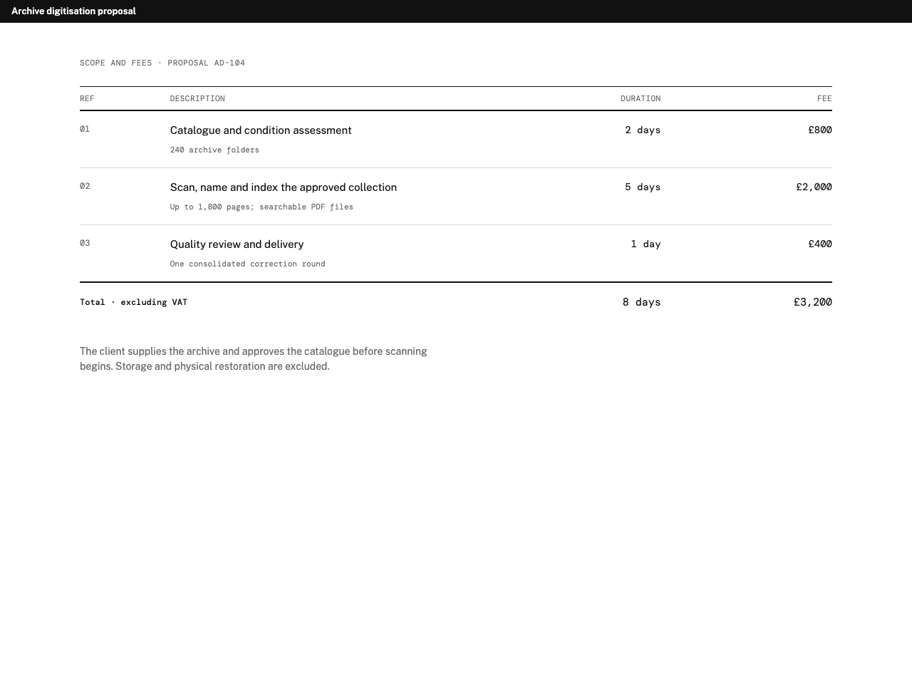
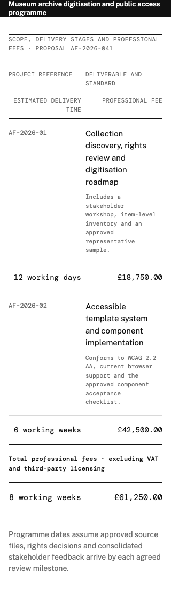

# Cross-repository reference loop

`reference_loop.py` exercises workflow 0.2 against the real sibling `standards-ui`
renderer. It uses Schedule as a compact repair example. The retained reference suite covers
all nine declared moves at standard and 320px widths. Neither Python harness makes a model
call; the UI checkout supplies its pinned Node and Chromium dependencies.

Prepare the renderer once with Node 22 or 24 LTS:

```bash
cd ../standards-ui
npm ci
npx playwright install chromium
cd ../standards-public
```

Run the proof:

```bash
python3 examples/workflow/reference_loop.py --ui ../standards-ui
```

The harness builds the UI, reads its support-manifest-bound identity, plans from the
brief, assembles the selected agent context, then retains four browser runs:

1. the unmodified Schedule and its passing report;
2. a seeded wrong total, its failing report and the initial repair decision;
3. the deterministic correction, freshly rendered, and a complete decision;
4. the same defective bytes submitted again, which stop as an oscillation while retaining
   the accepted best artifact for rollback.

Every stage keeps its HTML, embedded screenshot evidence, report or decision. Histories
include accepted and rejected attempts. `summary.json` records the plan/context hashes,
renderer identity, failed rules, successful correction and stop-on-repeat result. Pass
`--out PATH` to use a new or empty directory, or `--skip-build` when the UI is already
built.

This proves deterministic planning, binding, checking, history and repair-stop mechanics.
It does not establish comparative model performance, visual quality or the benefit of
automated repair.

## Retained nine-move references

The repository includes one synthetic standard case and one 320px stress case for every
supported move. These images let designers inspect the actual open components before
running the harness. They are review candidates, not designer-approved visual regression
baselines. The [reference manifest](reference-catalogue-r3/manifest.json) binds all 18 briefs to their
exact plans, selected contexts, artifacts, renderer/browser payload, evidence, reports and
screenshot hashes. Public tests recreate every plan and context, rerun the checker and
verify every file offline, without the UI repository or a browser.

| Job | Move | Standard | 320px stress case |
|---|---|---|---|
| Evidence | Plate | [desktop](reference-catalogue-r3/plate-standard-1280x960.png) · [mobile](reference-catalogue-r3/plate-standard-390x844.png) | [narrow](reference-catalogue-r3/plate-320-320x844.png) |
| Evidence | Register | [desktop](reference-catalogue-r3/register-standard-1280x960.png) · [mobile](reference-catalogue-r3/register-standard-390x844.png) | [narrow](reference-catalogue-r3/register-320-320x844.png) |
| Structure | Key | [desktop](reference-catalogue-r3/key-standard-1280x960.png) · [mobile](reference-catalogue-r3/key-standard-390x844.png) | [narrow](reference-catalogue-r3/key-320-320x844.png) |
| Evidence | Datum | [desktop](reference-catalogue-r3/datum-standard-1280x960.png) · [mobile](reference-catalogue-r3/datum-standard-390x844.png) | [narrow](reference-catalogue-r3/datum-320-320x844.png) |
| Structure | Matrix | [desktop](reference-catalogue-r3/matrix-standard-1280x960.png) · [mobile](reference-catalogue-r3/matrix-standard-390x844.png) | [narrow](reference-catalogue-r3/matrix-320-320x844.png) |
| Narrative | Band statement | [desktop](reference-catalogue-r3/band-statement-standard-1280x960.png) · [mobile](reference-catalogue-r3/band-statement-standard-390x844.png) | [narrow](reference-catalogue-r3/band-statement-320-320x844.png) |
| Change | Series | [desktop](reference-catalogue-r3/series-standard-1280x960.png) · [mobile](reference-catalogue-r3/series-standard-390x844.png) | [narrow](reference-catalogue-r3/series-320-320x844.png) |
| Transaction | Schedule | [desktop](reference-catalogue-r3/schedule-1280x960.png) · [mobile](reference-catalogue-r3/schedule-390x844.png) | [narrow](reference-catalogue-r3/schedule-long-320x844.png) |
| Wayfinding | Running index | [desktop](reference-catalogue-r3/running-index-standard-1280x960.png) · [mobile](reference-catalogue-r3/running-index-standard-390x844.png) | [narrow](reference-catalogue-r3/running-index-320-320x844.png) |

Regenerate the complete suite into a new directory with Node 22 or 24, then review its diff
before replacing the retained records:

```bash
python3 examples/workflow/reference_suite.py \
  --ui ../standards-ui \
  --out /tmp/standards-reference-suite \
  --skip-build
```

The generator refuses to overwrite a non-empty directory and fails if any planned fact,
relationship, viewport or screenshot check does not pass.

### Schedule repair reference

[Desktop reference, 1280 × 960](reference-catalogue-r3/schedule-1280x960.png) ·
[mobile reference, 390 × 844](reference-catalogue-r3/schedule-390x844.png)



[Retained plan](reference-catalogue-r3/schedule-plan.json) ·
[selected context](reference-catalogue-r3/schedule-context.json) ·
[static HTML](reference-catalogue-r3/schedule.html) ·
[render evidence](reference-catalogue-r3/schedule-render-evidence.json) ·
[checker report](reference-catalogue-r3/schedule-report.json)

The [long-content brief](schedule-long-brief.json) is the Schedule 320 × 844 stress case.
Its full-page reference must preserve every word, duration and fee without horizontal
overflow or mid-word breaks; column headings may occupy no more than two intact lines.

[Long-content reference, 320 × 844 viewport](reference-catalogue-r3/schedule-long-320x844.png)



[Long-content plan](reference-catalogue-r3/schedule-long-plan.json) ·
[selected context](reference-catalogue-r3/schedule-long-context.json) ·
[static HTML](reference-catalogue-r3/schedule-long.html) ·
[render evidence](reference-catalogue-r3/schedule-long-render-evidence.json) ·
[checker report](reference-catalogue-r3/schedule-long-report.json)

The rendered HTML embeds Public Sans and DM Mono. Their complete SIL Open Font License
1.1 notices are retained under [`reference-catalogue-r3/font-licenses/`](reference-catalogue-r3/font-licenses/).
